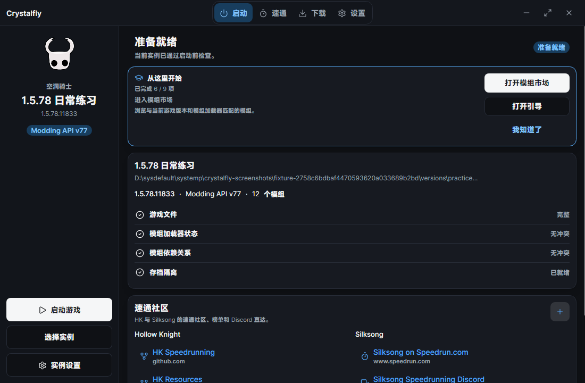
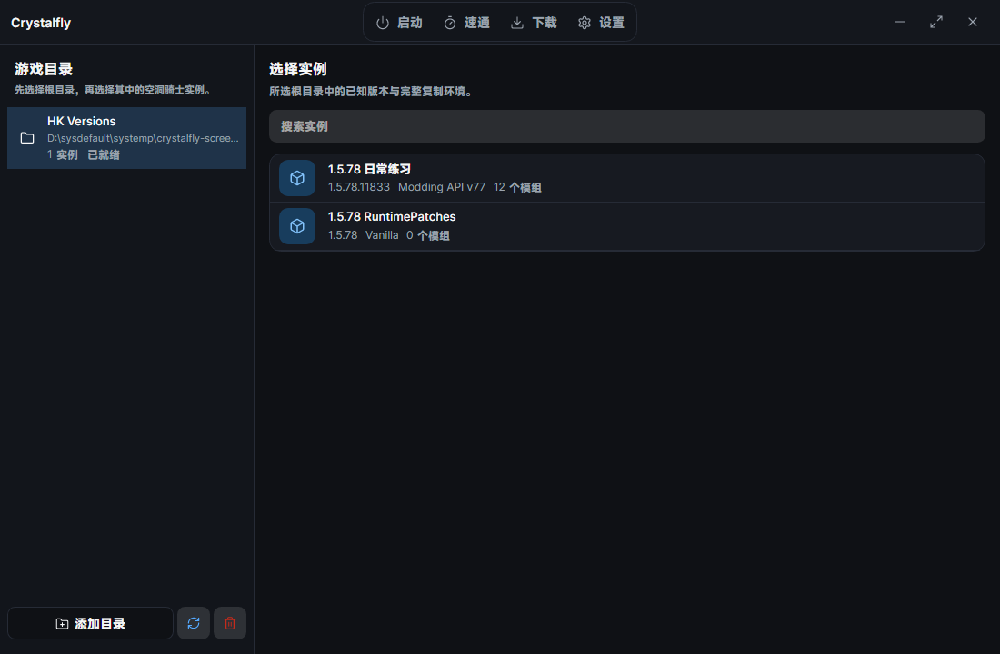
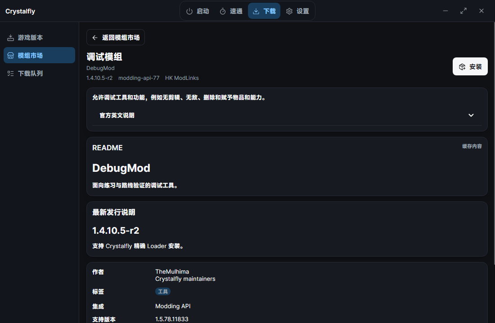
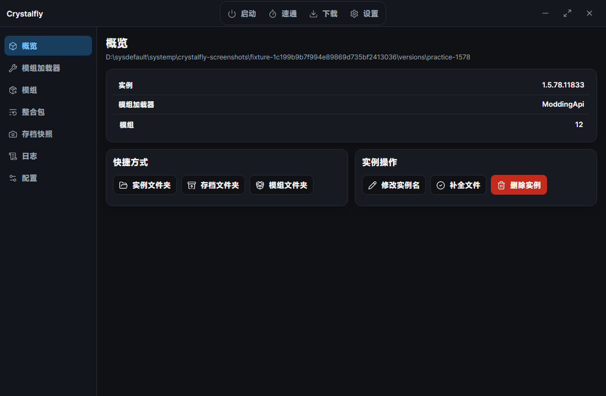
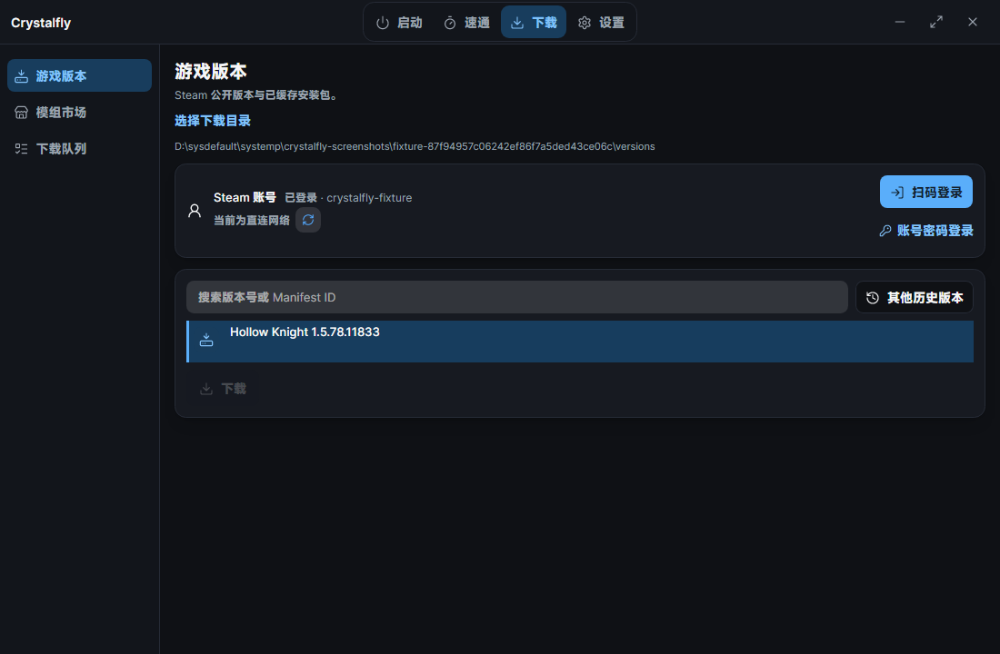
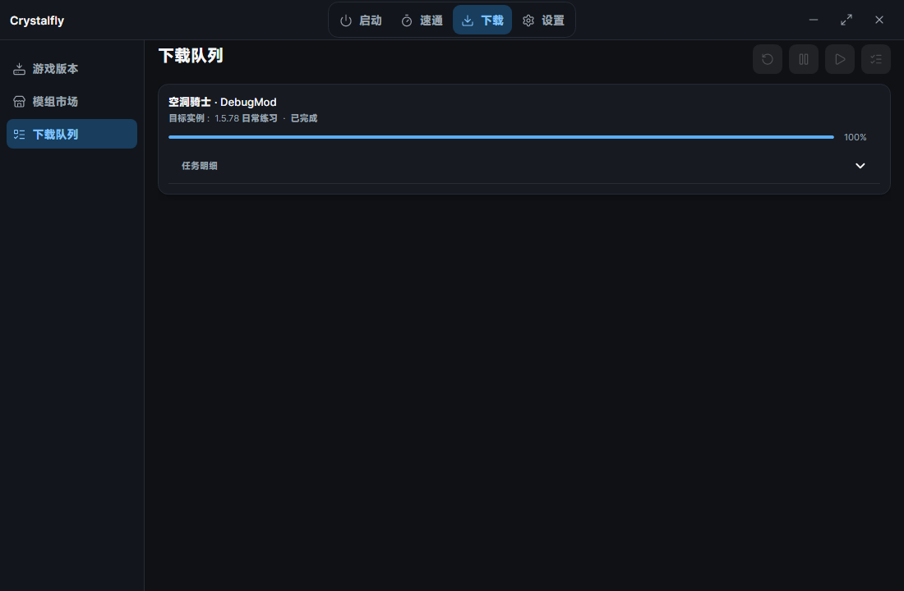
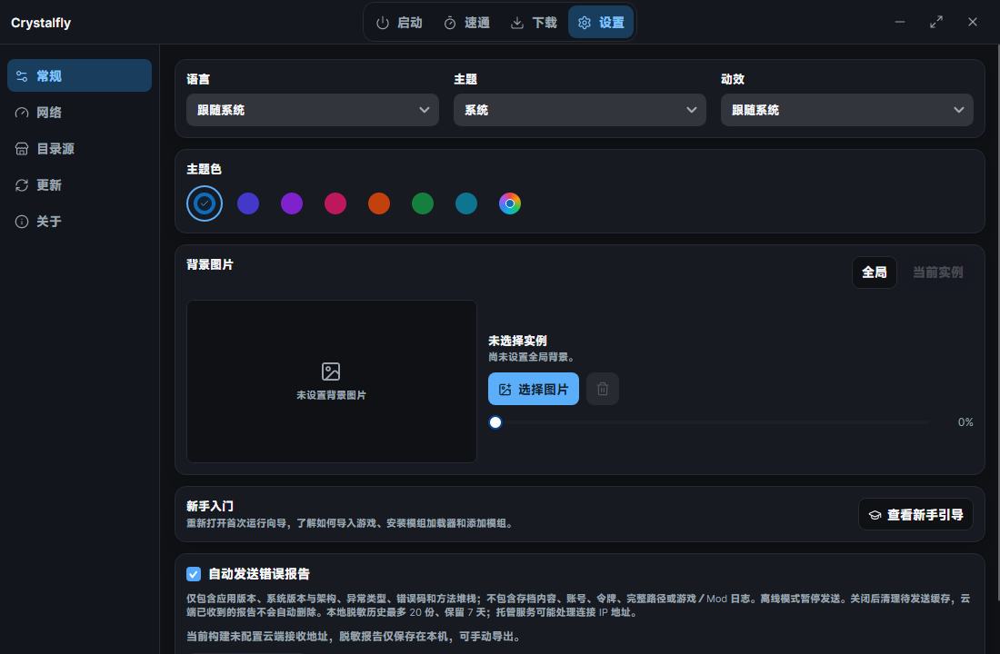
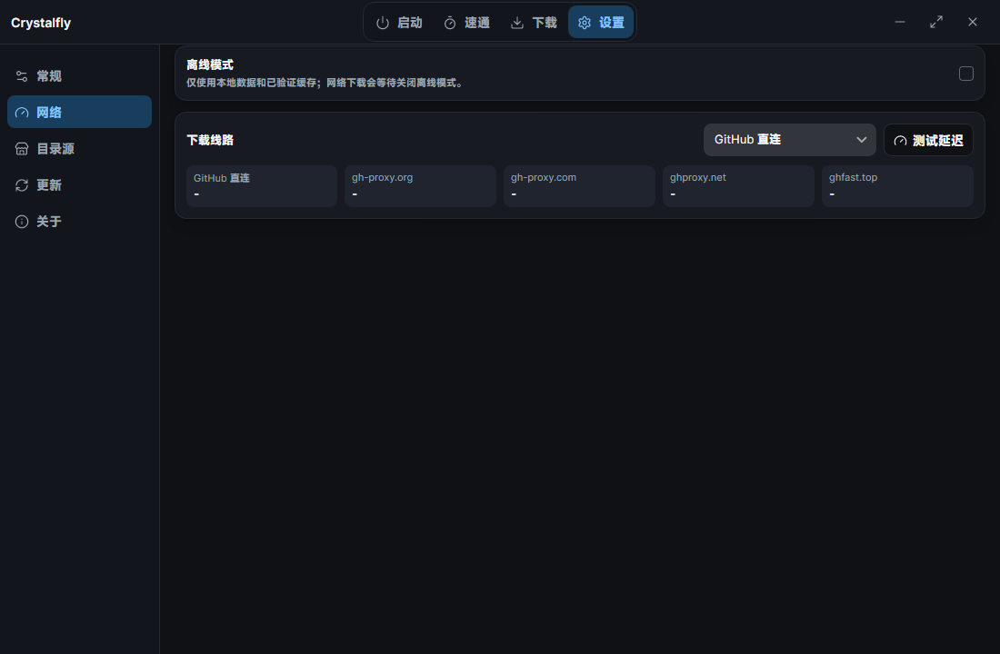

<div align="center">


# Crystalfly

**Two worlds. One workspace.**

Manage Hollow Knight and Hollow Knight: Silksong versions, mods, and saves. Keep everyday play, mod exploration, and speedrun practice organized.

[简体中文](README.md) · **English**

[](https://github.com/wzxnb2333/Crystalfly/releases/latest)

[](LICENSE)

**[Download latest](https://github.com/wzxnb2333/Crystalfly/releases/latest)** · [Quick start](#quick-start) · [Features](#features) · [Release notes](https://github.com/wzxnb2333/Crystalfly/releases) · [Report an issue](https://github.com/wzxnb2333/Crystalfly/issues)

</div>

---

## From game builds to every mod dependency

Keep vanilla, modded, and speedrun copies separate, with saves isolated per instance. Each game remembers its own libraries, selected instance, and filters.

<table width="100%">
  <tr>
    <td width="50%" align="center">
      <a href="docs/screenshots/readme-launch.png"></a>
      <br><sub>Launch & preflight checks</sub>
    </td>
    <td width="50%" align="center">
      <a href="docs/screenshots/readme-instances.png"></a>
      <br><sub>Game libraries & instance selection</sub>
    </td>
  </tr>
</table>

<p align="center"><sub>Click any screenshot for the full image. Screenshots use isolated demonstration data and show the Chinese UI.</sub></p>

| Games & instances | Mods & dependencies | Saves & practice |
| :--- | :--- | :--- |
| **Two game workspaces**<br>Separate libraries and instances for HK and Silksong | **Discover & install**<br>HK ModLinks, Silksong Thunderstore, and Chinese translations | **Isolated saves**<br>Per-instance data, named snapshots, four save slots |
| **Multiple versions**<br>Steam downloads, local imports, and full clones | **Manage your mods**<br>Enable, pin, update, repair, and inspect dependencies | **Share mod packs**<br>Append or exact mode, local JSON, and share codes |
| **Background downloads**<br>Dependency plans, progress, cancellation, and retry | **Visual dependencies**<br>Graphs for both games, box selection, and batch actions | **HK speedrun setups**<br>Dedicated copies, RuntimePatches, and pre-launch reports |

## Quick start

### 1. Install or extract

Choose a Windows x64 package from [Releases](https://github.com/wzxnb2333/Crystalfly/releases/latest):

| Package | Best for | How to use |
| :--- | :--- | :--- |
| `Crystalfly-<version>-win-x64-setup.exe` | A fixed installation | Run the installer; defaults to `D:\Program Files\Crystalfly` and requires administrator privileges |
| `Crystalfly-<version>-win-x64-portable.zip` | A location of your choice | Extract fully into a writable folder, run `Crystalfly.App.exe`, and keep `portable.flag` |

Release packages include the .NET runtime; no SDK is required. Steam downloads require an account that owns the selected game. Existing game installations can also be imported.

### 2. Choose a game and an instance

Follow the first-run guide, scan Steam libraries or add a local game directory, then open **Launch → Select Instance**. Click the Knight or Hornet portrait on Launch to switch games.

For another game version, use **Download → Game Versions** to download a separate instance.

### 3. Add mods and play

Open **Download → Mod Market**, select a mod and target instance, and confirm the dependency plan. Manage installed content under **Instance Settings → Mods**, then return to Launch to review checks and start playing.

> Track downloads, installations, and retries under **Download → Download Queue**. Reopen onboarding from **Settings → General** at any time.

## Features

### Know what you install and what it depends on

- **Discover content**: search and filter mods, inspect authors, versions, dependencies, READMEs, and release notes. The Chinese UI includes maintained translations, with original text as a fallback.
- **Preview the plan**: review the loader, recursive prerequisites, and requested mod before installation. Dependencies run in order; independent groups can download concurrently.
- **Maintain your setup**: inspect file health, repair managed content, pin versions, and enable, update, or uninstall mods in batches. Uninstall previews affected dependencies.
- **Explore both graphs**: see missing prerequisites and dependency links, arrange nodes freely, and apply actions to selected groups.

<table width="100%">
  <tr>
    <td width="50%" align="center">
      <a href="docs/screenshots/readme-market.png"></a>
      <br><sub>Mod Market</sub>
    </td>
    <td width="50%" align="center">
      <a href="docs/screenshots/readme-market-detail.png"></a>
      <br><sub>Mod details</sub>
    </td>
  </tr>
  <tr>
    <td width="50%" align="center">
      <a href="docs/screenshots/readme-dependencies.png"></a>
      <br><sub>Hollow Knight dependencies & multi-selection</sub>
    </td>
    <td width="50%" align="center">
      <a href="docs/screenshots/readme-silksong-mods.png"></a>
      <br><sub>Silksong mod management</sub>
    </td>
  </tr>
</table>

### Saves that stay with their instance

Crystalfly switches per-instance LocalLow data before launch, captures it after exit, and restores the original shared data. Create named snapshots and edit four save slots from an instance or snapshot. Translated field labels appear alongside original keys; unknown fields are preserved.

Silksong has its own field dictionary and DAT import/export. Configuration editing preserves unknown entries, and save writes include backups and validation.

### Mod packs and speedruns, each with their own setup

**Mod packs** record the game build, loader, and managed mod versions, and can be shared through JSON or share codes. Append mode fills gaps; exact mode also synchronizes enabled states. You can restore the prior state, while pinned mods and their dependencies remain protected.

**Hollow Knight speedrun environments** create separate copies from clean vanilla instances, with RuntimePatches templates for `1.2.2.1`, `1.4.3.2`, and `1.5.78`, plus pre-launch verification reports. Available options vary by build and default to off; competition eligibility follows community rules. Silksong currently has no official speedrun templates.

<table width="100%">
  <tr>
    <td width="50%" align="center">
      <a href="docs/screenshots/readme-saves.png"></a>
      <br><sub>Save editor</sub>
    </td>
    <td width="50%" align="center">
      <a href="docs/screenshots/readme-modpacks.png"></a>
      <br><sub>Mod packs & sharing</sub>
    </td>
  </tr>
  <tr>
    <td width="50%" align="center">
      <a href="docs/screenshots/readme-speedrun.png"></a>
      <br><sub>Hollow Knight speedrun environments</sub>
    </td>
    <td width="50%" align="center">
      <a href="docs/screenshots/readme-instance-detail.png"></a>
      <br><sub>Instance overview</sub>
    </td>
  </tr>
</table>

### Make it yours

Light and dark themes, English and Simplified Chinese, accent colors, global or per-instance backgrounds, and system, reduced, or disabled motion. Offline mode uses existing valid caches. GitHub downloads support route tests, smart selection, and fallback. App updates verify signed manifests and provide progress, cancellation, and retry.

<details>
<summary><strong>More screens · Downloads & personalization</strong></summary>

<table width="100%">
  <tr>
    <td width="50%" align="center">
      <a href="docs/screenshots/readme-versions.png"></a>
      <br><sub>Steam game version downloads</sub>
    </td>
    <td width="50%" align="center">
      <a href="docs/screenshots/readme-queue.png"></a>
      <br><sub>Background download queue</sub>
    </td>
  </tr>
  <tr>
    <td width="50%" align="center">
      <a href="docs/screenshots/readme-settings.png"></a>
      <br><sub>Themes & appearance</sub>
    </td>
    <td width="50%" align="center">
      <a href="docs/screenshots/readme-network.png"></a>
      <br><sub>Network routes & connection tests</sub>
    </td>
  </tr>
</table>

</details>

## Find your way

| Task | Entry point |
| :--- | :--- |
| Switch games | Launch portrait; `Shift+Tab` outside Instance Settings |
| Select, clone, or delete an instance | Launch → Select Instance |
| Install or repair a loader | Instance Settings → Mod Loader |
| Manage installed mods and dependency graphs | Instance Settings → Mods |
| Create or apply a mod pack | Instance Settings → Mod Packs |
| Create snapshots or edit saves | Instance Settings → Save Snapshots |
| Read loader and game logs | Instance Settings → Logs |
| Download games, mods, or retry failed tasks | Download → Game Versions / Mod Market / Download Queue |
| Change network routes, catalog sources, or check updates | Settings → corresponding section |

In dependency graphs, `Ctrl`/`Shift` click selects multiple nodes, `Shift` drag selects a box, and dragging a selected node moves the group. Use `Ctrl+A` to select all and `Esc` to clear.

## Data & privacy

| Data | Location |
| :--- | :--- |
| Installed-mode settings | `%LOCALAPPDATA%\Crystalfly` |
| Portable settings | `Data` beside the executable, enabled by `portable.flag` |
| Instance metadata, transactions, isolated saves, and snapshots | `.crystalfly` under the active game directory; Silksong uses separate subpaths |
| Instance identity | `.crystalfly-instance.json` inside the instance directory |

Remembered Steam credentials are encrypted with Windows DPAPI for the current user. Official builds configured with a reporting destination enable sanitized error reports by default; turn them off in **Settings → General**. Reports exclude saves, credentials, full paths, and game/mod logs. See [error reporting and privacy](docs/error-reporting.md#english-notice) for fields, hosting, retention, and source-build behavior.

## Development & documentation

Running from source requires Windows and the [.NET SDK 10](https://dotnet.microsoft.com/download/dotnet/10.0):

```powershell
dotnet restore '.\Crystalfly.slnx'
dotnet run --project '.\src\Crystalfly.App\Crystalfly.App.csproj'
```

| Document | What it covers |
| :--- | :--- |
| [Usage and maintenance](docs/user-guide.en.md) | HK compatibility, install and launch rules, storage, and release builds |
| [Silksong & Thunderstore](docs/silksong-thunderstore.md) (Chinese) | Version management, installation, isolated saves, and migration |
| [Silksong verification](docs/silksong-verification.md) (Chinese) | Validation scope, results, and known limitations |
| [Architecture](docs/architecture.md) | Modules, file transactions, storage, and recovery |
| [HK translations](docs/mod-translations.zh-CN.md) · [Silksong translations](docs/silksong-mod-translations.zh-CN.md) (Chinese) | Translation sources, fallback, and maintenance |
| [Contribution guidelines](AGENTS.md) | Code style, focused checks, and local builds |

Use [Issues](https://github.com/wzxnb2333/Crystalfly/issues) for bugs and suggestions. Include the app version, reproduction steps, and a sanitized error report. Keep credentials, game files, and personal saves out of public reports.

---

<div align="center">

**Crystalfly** · Built with .NET 10, Avalonia & SteamKit2

Project code is licensed under [GPL-3.0-only](LICENSE). A community tool, unaffiliated with Team Cherry.<br>
Games, character artwork, loaders, and mods retain their owners' rights and licenses. Game files are not distributed by this repository.

</div>
