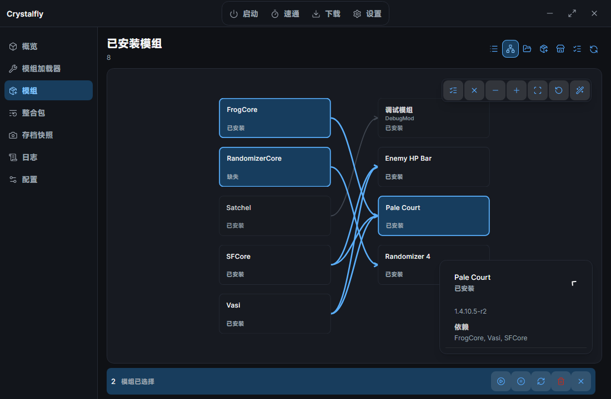
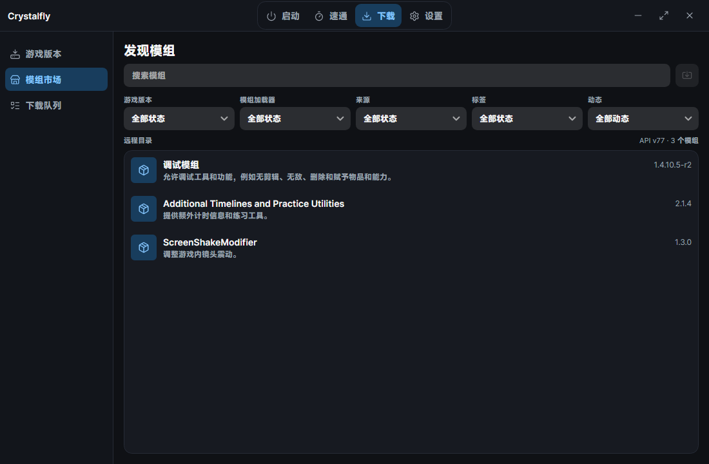
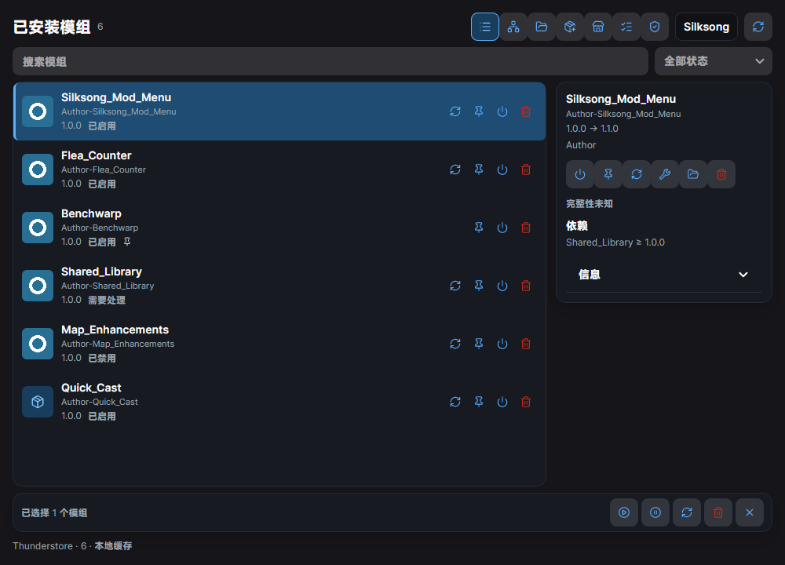
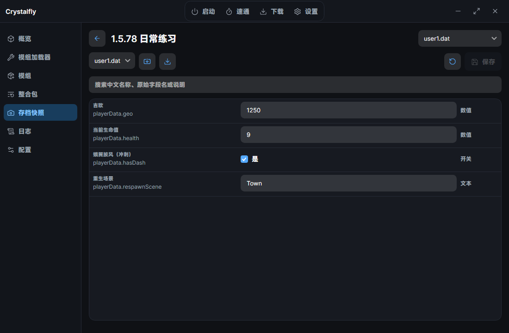
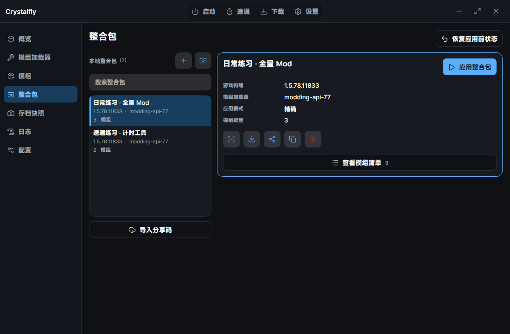
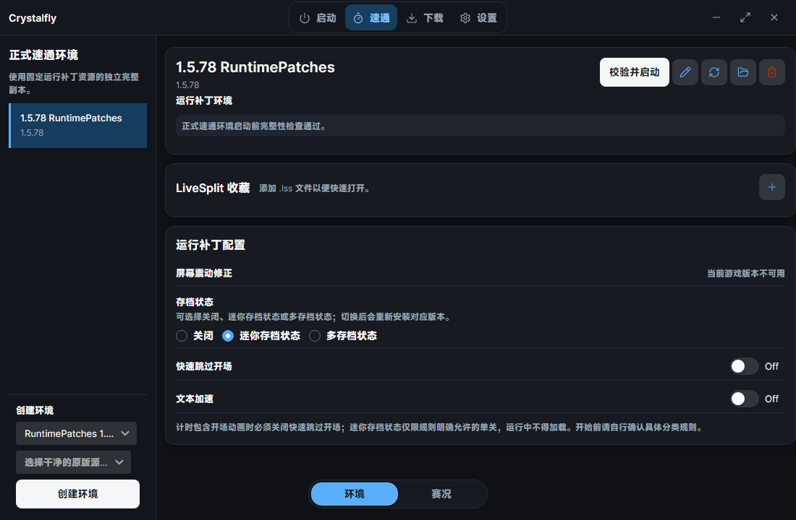

<div align="center">


# Crystalfly

**两个世界，一个工作台。**

《空洞骑士》与《丝之歌》的版本、模组与存档管理器。为日常游玩、模组探索和速通练习整理好一切。

**简体中文** · [English](README.en.md)

[](https://github.com/wzxnb2333/Crystalfly/releases/latest)

[](LICENSE)

**[下载最新版](https://github.com/wzxnb2333/Crystalfly/releases/latest)** · [快速上手](#快速上手) · [功能指南](#功能指南) · [更新记录](https://github.com/wzxnb2333/Crystalfly/releases) · [反馈问题](https://github.com/wzxnb2333/Crystalfly/issues)

</div>

---

## 从游戏版本到每一条模组依赖

原版、模组和速通副本分别管理，存档随实例隔离。切换游戏时，目录、当前实例和筛选条件各自保留。



<p align="center"><sub>依赖图支持自由布局、多选与框选；模组详情收纳在画布内。</sub></p>

| 游戏与实例 | 模组与依赖 | 存档与练习 |
| :--- | :--- | :--- |
| **双游戏工作区**<br>空洞骑士与丝之歌分别保存目录和实例 | **发现与安装**<br>HK ModLinks、丝之歌 Thunderstore 与中文内容 | **独立存档**<br>实例隔离、命名快照、四槽位编辑 |
| **多版本管理**<br>Steam 下载、本地导入、完整克隆 | **完整管理**<br>启停、固定、更新、修复与依赖检查 | **整合包分享**<br>追加或精确应用、本地 JSON 与分享码 |
| **后台下载**<br>依赖计划、进度、取消与失败重试 | **可视化依赖**<br>双游戏依赖图、多选、框选与批量操作 | **HK 速通环境**<br>独立副本、RuntimePatches 与启动前报告 |

## 快速上手

### 1. 安装或解压

在 [Releases](https://github.com/wzxnb2333/Crystalfly/releases/latest) 选择适合你的 Windows x64 版本：

| 下载项 | 适用场景 | 使用方式 |
| :--- | :--- | :--- |
| `Crystalfly-<版本>-win-x64-setup.exe` | 固定在这台电脑使用 | 运行安装包，默认安装至 `D:\Program Files\Crystalfly`，需要管理员权限 |
| `Crystalfly-<版本>-win-x64-portable.zip` | 自选位置、便携使用 | 完整解压到可写目录，运行 `Crystalfly.App.exe`，保留 `portable.flag` |

发行包已包含 .NET 运行时，无需另装 SDK。Steam 下载需要登录拥有对应游戏的账号；已有游戏也可以直接导入。

### 2. 选择游戏，登记实例

首次启动跟随引导，扫描 Steam 库或添加本地游戏目录，再从 **启动 → 选择实例** 进入游戏副本。点击启动页的小骑士／大黄蜂头像切换游戏。

需要另一个版本时，进入 **下载 → 游戏版本**，下载到独立实例。

### 3. 添加模组，开始游玩

进入 **下载 → 模组市场**，选择模组、目标实例并确认依赖计划。在 **实例设置 → 模组** 中管理已安装内容，回到启动页查看预检结果并启动。

> 下载、安装和重试进度统一位于 **下载 → 下载队列**。新手引导可在 **设置 → 常规** 重新打开。

## 功能指南

### 模组，装得明白，也管得清楚

- **发现内容**：搜索与筛选模组，查看作者、版本、依赖、README 和发行说明。中文界面提供维护中的译名与说明，缺失内容回退原文。
- **先看计划再安装**：预览加载器、递归前置与主模组；后台按依赖顺序处理，独立安装组可并发下载。
- **维护已有模组**：检查文件状态、修复受管理内容、固定版本并批量启停、更新或卸载。卸载前展示依赖影响。
- **双游戏依赖图**：查看缺失前置和依赖连线，自由拖动节点，并通过多选执行批量操作。

<details>
<summary><strong>查看模组市场与丝之歌管理界面</strong></summary>

<br>





<sub>界面截图使用隔离演示数据；用于展示布局与操作，不代表完整在线目录。</sub>

</details>

### 存档，跟着实例走

启动前切换实例专属 LocalLow，退出后回收并恢复原共享数据。可以创建命名快照，在当前实例或快照中编辑四个存档槽位；中文字段名称与原始键名并列，未知字段保留。

丝之歌提供独立的字段词库与 DAT 导入导出。配置编辑保留未知项目，存档写入前备份，并执行校验。

### 整合包与速通，各有自己的环境

**整合包**保存游戏构建、加载器和受管理模组版本，可通过 JSON 或分享码传递。追加模式补齐缺失内容，精确模式同步启停；应用前状态可恢复，固定模组及其依赖受到保护。

**空洞骑士速通环境**从干净原版创建独立副本，支持 `1.2.2.1`、`1.4.3.2`、`1.5.78` 的 RuntimePatches 模板与启动前验证报告。模板可用开关随版本变化，默认关闭；具体比赛分类以社区规则为准。丝之歌目前不提供正式速通模板。

<details>
<summary><strong>查看存档、整合包与速通界面</strong></summary>

<br>







</details>

### 适应你的使用习惯

明暗主题、中英文界面、主题色、全局与实例独立背景，以及跟随系统、减少或关闭动画。离线模式可使用已有有效缓存；GitHub 下载支持线路测试、智能选择与失败回退。应用更新使用签名清单验证，支持进度、取消和重试。

## 常用操作

| 想做什么 | 从哪里开始 |
| :--- | :--- |
| 切换游戏 | 启动页头像；实例设置外可按 `Shift+Tab` |
| 选择、克隆或删除实例 | 启动 → 选择实例 |
| 安装或修复加载器 | 实例设置 → 模组加载器 |
| 查看已安装模组与依赖图 | 实例设置 → 模组 |
| 创建或应用整合包 | 实例设置 → 整合包 |
| 创建快照或编辑存档 | 实例设置 → 存档快照 |
| 查看加载器与游戏日志 | 实例设置 → 日志 |
| 下载游戏、模组或处理失败任务 | 下载 → 游戏版本／模组市场／下载队列 |
| 修改网络、目录源或检查更新 | 设置 → 对应页面 |

在依赖图中，`Ctrl`／`Shift` 点击多选，`Shift` 拖动框选，拖动选中节点可整体移动；`Ctrl+A` 全选，`Esc` 清空。

## 数据与隐私

| 内容 | 位置 |
| :--- | :--- |
| 安装版设置 | `%LOCALAPPDATA%\Crystalfly` |
| 便携版设置 | 程序旁的 `Data`，由 `portable.flag` 启用 |
| 实例元数据、事务、隔离存档与快照 | 当前游戏目录下的 `.crystalfly`；丝之歌使用独立子路径 |
| 实例身份 | 实例目录中的 `.crystalfly-instance.json` |

Steam 记住的凭据使用当前 Windows 用户的 DPAPI 加密。配置了接收地址的官方构建默认发送脱敏错误报告，可在 **设置 → 常规** 关闭；报告不包含存档、凭据、完整路径或游戏／模组日志。字段范围、托管地区、保留期及源码构建策略见 [错误报告与隐私说明](docs/error-reporting.md)。

## 开发与文档

从源码运行需要 [.NET SDK 10](https://dotnet.microsoft.com/download/dotnet/10.0) 和 Windows：

```powershell
dotnet restore '.\Crystalfly.slnx'
dotnet run --project '.\src\Crystalfly.App\Crystalfly.App.csproj'
```

| 文档 | 内容 |
| :--- | :--- |
| [使用与维护指南](docs/user-guide.zh-CN.md) | HK 兼容矩阵、安装与启动规则、本地 Loader、数据与发布构建 |
| [丝之歌与 Thunderstore](docs/silksong-thunderstore.md) | 多版本管理、安装规则、存档隔离与旧数据迁移 |
| [丝之歌验证记录](docs/silksong-verification.md) | 验证范围、结果与已知限制 |
| [架构说明](docs/architecture.md) | 模块、文件事务、存储和恢复机制 |
| [HK 模组翻译](docs/mod-translations.zh-CN.md) · [丝之歌模组翻译](docs/silksong-mod-translations.zh-CN.md) | 翻译来源、回退规则与维护方式 |
| [贡献约定](AGENTS.md) | 代码风格、定向测试与本地构建交付 |

欢迎通过 [Issues](https://github.com/wzxnb2333/Crystalfly/issues) 报告问题或提出建议。请附应用版本、复现步骤和脱敏错误报告，勿上传账号凭据、游戏文件或个人存档。

---

<div align="center">

**Crystalfly** · 基于 .NET 10、Avalonia 与 SteamKit2

项目代码采用 [GPL-3.0-only](LICENSE)。本项目为社区工具，与 Team Cherry 无隶属关系。<br>
游戏、角色美术、加载器与模组的权利及许可归各自所有者；仓库不分发游戏文件。

</div>
